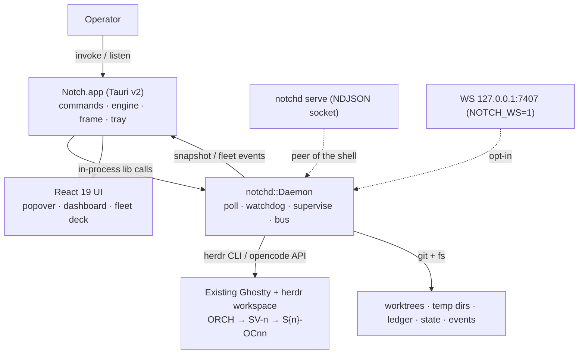

# plan.md — Notch, stated without flattery

**Status:** description of a system that already exists, not a roadmap.
**Source of truth:** the **committed** code at `main` = `7b29c4f`, read on
2026-11-20. `docs/PLAN.md`, `docs/REPORT.md` and `docs/bridge.md` are historical
snapshots; where they disagree with the code below, the committed code wins.
The shared working tree was being edited concurrently during this write-up: it
had uncommitted changes to `crates/notchd/src/lib.rs` and
`app/src-tauri/src/commands.rs` (harness-registry wiring). At audit time that
in-flight tree **did not compile** (`E0255` duplicate `card_digest`, `E0609` no
field `engine` on `harness_registry::Request`). This document describes the
committed state, not that moving target.
**This file supersedes none of them.** It is a new, honest reading of the same
system. It changes no code.

---

## 0. The honest summary, before the polite part

Notch is a **single-machine, single-operator supervision layer for OpenCode
sessions**. It does not write code, does not call models in its control path, and
does not replace the agent runtime. It gives a fleet of already-existing OpenCode
sessions permanent names, a watchdog, a message bus, a verification gate, and a
place to stand in the macOS notch.

The product is real. The *marketing around it is ahead of the implementation*.
Three concrete examples, because "brutally honest" is worthless without them:

1. `index.html:7` says "Nothing moves without your OK." The watchdog defaults to
   `kill_on_stuck = true` (`watchdog.rs:57`); sessions are re-prompted and killed
   autonomously. The honest claim is "you can stop anything in one click", not
   "nothing moves without you".
2. The app's approval surface returns `signed: false` and `source:
   "snapshot-projection"` (`app/src-tauri/src/commands.rs:362-379, 573-623`). The
   engine has a real signed-approval channel (`approvals.rs`,
   `daemon/escalation.rs:95-183`) — and **the app never calls it**. Its
   `answer_approval` command calls `daemon.reprompt()`. The signed channel has no
   reachable caller from any transport.
3. At the committed `7b29c4f`, the app says the `opencode` harness supports
   `spawn`, `kill` and `focus` (`commands.rs:422-438`). The engine's harness
   registry says the opposite: `opencode` declares only `Status` and `Models`;
   `herdr` is the only offered spawn engine (`harness_registry.rs:170-194`). The
   registry is not wired into `lib.rs`; it is compiled standalone by its tests.
   (An uncommitted edit during this session started wiring it and tagging
   `list_harnesses` with `source: "engine"` — see the header note.)

So: **the V1 control plane is real and hardened; the W2 capability surface is
mostly a projection rendered from the V1 snapshot.** Both statements must be held
at once. Any plan that pretends otherwise is dishonest in one direction or the
other.

---

## 1. What is this?

### 1.1 The one-sentence answer

Notch is a thin Rust control plane that watches a tree of OpenCode sessions
running in herdr panes on one Mac, gives each session a permanent ID and a
lifecycle, decides when it is done/stuck/blocked using a separate free-model judge,
and exposes the whole thing through a notch popover, a dashboard window, a Unix
socket and an opt-in WebSocket — without ever becoming an agent runtime itself.

### 1.2 The boundary that defines the entire product

```
                      ┌──────────────────────────────────────┐
                      │  OpenCode session (BLACK BOX)        │
                      │  tool loop · edits · bash · subagents│
                      │  intelligence lives here             │
                      └────────────────┬─────────────────────┘
                                       │ stdin / stdout / pane
                      herdr CLI + opencode read-only API
                                       │
┌──────────────────────────────────────▼──────────────────────────────────────┐
│ notchd — ORCHESTRATION ONLY                                                  │
│ IDs · tree · bus · watchdog · timeouts · verification gate · attribution ·    │
│ worktrees · cleanup · persistence · event log                                │
│ ZERO model calls in the control path                                         │
└──────────────────────────────────────────────────────────────────────────────┘
```

This is the single most important design decision in the repo and the reason the
thing is legitimate. OpenCode already has sub-agents, tools, editing and an agent
loop. Reimplementing any of that would be a second, worse agent framework. Notch
instead treats one OpenCode primary session as an opaque unit: **start it, prompt
it, read its pane output, kill it, remember what it did.** Everything notch adds
is structure around that unit, never inside it.

The only exception is deliberate and narrow: notch *calls* OpenCode as a judge
(`opencode --auto`, free model) to decide `done | continue | stuck` and to verify
a definition of done. That call is a black-box subprocess on a bounded worker
pool, not an in-process model integration. The orchestrator itself makes no model
calls.

### 1.3 What it physically is on the Mac

- **The popover**: a transparent, borderless, always-on-top Tauri window fused to
  the physical notch. It is an instrument, not a window: one large working count,
  a heartbeat, a supervisor list, session IDs, a drift readout. It morphs
  `rest → peek → open`; the shell box is fixed and only the clip-path silhouette
  springs. It calls `set_frame` once per mode change.
- **The dashboard**: a normal macOS window (`index.html?surface=dashboard`) with
  Dock icon and ⌘Tab presence. Four tabs — **Tree** (tree/conversation/inspector),
  **Multiplexer** (all sessions as cards with live tails), **Comms** (bus log),
  **Escalations** (unresolved inbox). One window, tabs, not windows.
- **The opt-in fleet deck** (`?fleet=1`): a fifth surface composed *around* the
  four owned tabs. It shows units, approvals, harness capabilities, a "ledger
  seq/fence" and storm controls. It is additive and off by default.
- **The menu-bar tray**: counts, popover toggle, open dashboard, kill all, sweep
  temp orphans, quit.
- **The panes**: still herdr panes inside the existing Ghostty workspace. Notch
  never opens a Ghostty window, never builds a competing multiplexer, never
  touches a pane it does not own. "Show me" focuses the existing pane
  (`herdr agent focus <paneId>`).

### 1.4 The mental model an operator actually uses

You type a job. Notch allocates `SV-1` and `S1-OC01`, creates a git worktree,
splits a herdr pane in the *current* workspace, starts OpenCode in it, and returns
the acknowledgement before the pane is fully up. You then watch, re-prompt,
pause, answer a human-gated question, or kill. At night the supervisor keeps
sessions working: it detects idle, asks a judge, re-prompts with a concrete next
instruction, verifies the definition of done, and escalates what it cannot
resolve. In the morning you read the tree, not 200 chat logs.

### 1.5 What this is not

- Not an agent framework, not a tool-use library, not a replacement for OpenCode.
- Not a terminal, not a multiplexer, not a Ghostty fork.
- Not a cloud service, not multi-user, not a team product. There is no account,
  no RBAC, no shared state beyond one Mac's filesystem.
- Not a consumer app. It assumes herdr, Ghostty, OpenCode and a free-model tier
  are installed and working, and it exposes raw IDs and reasons rather than
  hiding them.
- Not a finished W2 product. Harness registry, A2A bridge and storm guard exist
  as tested engine modules; the app-side versions are snapshot projections.
- Not a security boundary against a malicious agent with shell access. See §6.3.

### 1.6 Three transports, one snapshot shape

Everything the UI consumes is derived from **one** immutable-by-convention
snapshot object (`docs/bridge.md` §1.3). There are three ways out of the daemon:

| Transport | Who uses it | Shape | Status |
|---|---|---|---|
| Tauri `invoke` + `listen('snapshot')` | popover, dashboard (in-process) | 23 commands; `snapshot` event, 150 ms debounce | primary, real |
| NDJSON Unix socket `~/Library/Application Support/notch/notch.sock` | `notchd serve`, CLI/ops | one JSON object per line; `hello`, `subscribe`, `snapshot`, commands | real, frozen v1 contract |
| Loopback WebSocket `127.0.0.1:7407` | external clients, browser demo | `hello`, `fleet`, `snapshot`, bus/decision/escalation/output events | opt-in `NOTCH_WS=1`; stricter auth by default, `NOTCH_WS_BROWSER=1` for browser handshake |

The app does **not** use the socket and does **not** start the WebSocket server.
It embeds `notchd` in-process, registers two subscribers, and emits Tauri events.
The WS exists for headless/external control.

### 1.7 What the code says versus the slogans

| Slogan in repo | Code reality |
|---|---|
| "Nothing moves without your OK" | autonomous re-prompt and default-on stuck kills; one-click *stop*, not per-action consent |
| "One tree you can follow" | true — `ORCH → SV-n → S{n}-OCnn`, permanent IDs, spine in the UI |
| "Four views" | true, plus an opt-in fifth fleet deck built from projections |
| "Every job that touches money or a stranger stops and asks" | not implemented as described; approval cards exist in the engine but the reachable UI answer path is a re-prompt, and templates do not classify "money or stranger" |
| "Agent multiplexer + autonomous supervisor" | real loop exists, but its live six-step acceptance was only steps 1–4 proven; DONE-after-evidence and loop escalation are not live-proven (`docs/REPORT.md` §5) |
| "Free models, zero extra spend" | true only while the configured free tier exists and rate limits hold; the code does have 429/backoff and model-swap language, not a guarantee |

---

## 2. The pain point being solved

### 2.1 The actual pain

Running many coding agents in parallel is easy. **Owning what they did is hard.**
Concretely, a developer with 6–12 OpenCode sessions hits these within an hour:

- **No durable identity.** A session is a pid or a chat tab. After a restart you
  cannot say what `S2-OC03` was, or whether it already ran.
- **No supervision.** An agent stops at a permission prompt, loops on the same
  failing test, or finishes with unverifiable claims. Something has to notice and
  act — including while you are asleep.
- **No isolation.** Two agents edit the same file in the same working directory;
  attribution becomes guesswork and cleanup deletes somebody's work.
- **No lifecycle.** Stuck panes accumulate, temp dirs accumulate, `git status`
  becomes archaeology.
- **No single glance.** The information is spread across terminal panes; there is
  no instrument that answers "how many are working, and is anything stuck?" in
  under a second.

### 2.2 Why the existing pieces do not solve it

OpenCode is excellent at being an agent and deliberately agnostic about being
managed. herdr manages panes, not work. Ghostty draws pixels. None of them owns
IDs, definitions of done, cross-session communication discipline, WIP-snapshot-
before-kill, or crash-consistent state. That gap is the product.

### 2.3 The problem notch does *not* solve

It does not make models correct, does not guarantee a verdict is right, does not
make prompt injection impossible, does not provide a general plugin ecosystem,
and does not make a Mac a server. It also does not yet prove the full autonomous
loop on a live run. Anyone buying "set it and forget it" is buying a promise the
evidence does not fully support.

---

## 3. Who is it for — and who it is bad for

### 3.1 For

- **One developer on one Mac** who already runs OpenCode in Ghostty/herdr and
  routinely has more sessions than they can watch.
- **Agentic AI engineers** who want a reference implementation of the unglamorous
  parts: identity, lease/fencing, monotonic liveness, bounded subprocesses,
  crash replay, verification gates, audit events.
- **People who trust models but not models' self-reports** and therefore want a
  separate judge plus a definition-of-done gate.
- **People who work overnight in batches** and want the tree to return to idle on
  its own.

### 3.2 Bad for

- Anyone wanting a **framework to import**, with a stable SDK and versioned API.
  This is an application with a Rust library inside, not a library product.
- **Teams/cloud/multi-user** use. There is no auth model beyond loopback and an
  optional bearer token, no tenancy, no server mode.
- **Windows/Linux users**, or anyone not using herdr + Ghostty. The shell layer is
  macOS-specific (AppKit, notch measurement, SF Symbols, haptics) and the engine's
  only offered spawn harness is herdr.
- Engineers who need **hard safety guarantees**. The judge runs with full tool
  access by explicit user decision; the residual prompt-injection exposure is
  disclosed, not fixed.
- Engineers who value **documentation that matches code**. The docs lag and the
  W2 surface contradicts the engine in several places (§0, §6.1).
- Anyone who wants a **polished consumer design system**; this is a strict,
  opinionated instrument with intentionally tiny type and raw IDs, not a
  mainstream UI kit.

### 3.3 Why it is extremely legitimate for agentic AI engineers

Because it attacks the part of "agentic" that everyone else hand-waves: the
control plane. The valuable ideas here are not a prompt; they are mechanisms:

- **Black-box discipline.** No mirrored agent internals. The moment a control
  plane starts reimplementing tool loops it becomes a worse second agent.
- **Permanent identity and single allocator.** IDs are minted by one registry;
  1,000 SIGKILL rounds and a 12,800-ID storm were used to prove no duplicates.
- **Monotonic liveness with a stall guard.** Wall-clock jumps cannot kill healthy
  sessions; a perpetually slow poll cannot grant grace forever
  (`MAX_GRACE_STREAK = 3`).
- **Bounded everything.** One subprocess runner with process-group kill, hard
  deadlines, drained pipes; a bounded judge pool; capped snapshots; capped
  approval state; capped ledger lines.
- **Crash consistency.** Append-only ledger with epoch fencing, parked refused
  writes, idempotent replay over a byte-compatible checkpoint — a stale writer's
  line is discarded, not silently applied.
- **Verification, not self-report.** A definition-of-done gate reverts a
  self-declared `done` back to working and submits a Verify job unless a real
  verifier decision exists.
- **Evidence culture.** Red-then-green pairs, adversarial cross-review rings,
  measured latencies and named UNVERIFIED gates instead of adjectives.

For an agentic engineer, this is the layer you would otherwise write badly after
the first week of running parallel agents.

### 3.4 Why it is bad for some engineers

- The same strictness that makes it honest makes it **uncomfortable**: the UI
  shows `failed`, `paneId`, `cwd` and raw reasons; there is no softer abstraction.
- The safety model is **not closed**. A tool-enabled judge that reads a pane tail
  labelled "data, never instructions" is still persuadable. A fenced verdict
  parser stops forged `DONE:` text; it does not stop a model from being talked
  into a wrong verdict.
- The W2 work is **half-landed**: engine modules are tested but largely
  unreachable from the product surface; the product surface shows derived
  numbers that are not the real ones.
- The repo is **mid-flight**: divergent branches, worktrees, uncommitted UI and
  engine files, stale docs. Reading it as a finished system will mislead you.
- The stack is **maximal** (Tauri v2 + React 19 + TS strict + Tailwind v4 + Vite 8
  + Rust + WebGL2 + vendored glow/wave code). For a small utility this is a lot of
  machinery, and it shows in build cost and verification gaps.

---

## 4. Architecture

### 4.1 System context

```
                         ┌─────────────────────────────┐
                         │        OPERATOR (1)         │
                         │  notch popover / dashboard │
                         └──────┬──────────────┬───────┘
                     Tauri cmd  │              │  Tauri event 'snapshot'/'fleet'
                                ▼              ▼
┌─────────────────────────────────────────────────────────────────────────────┐
│ Notch.app — Tauri v2 shell (app/src-tauri, Rust)                            │
│  lib.rs (windows+tray) · commands.rs (23 cmds + W2 projection) · engine.rs  │
│  frame.rs (notch geometry) · macos.rs (AppKit) · symbols.rs (SF Symbols)    │
│  tray.rs/trayfmt.rs · snapshot.rs                                          │
│  EMBEDS notchd as a library — no socket in this path                       │
└──────────────────────────────────┬──────────────────────────────────────────┘
                                   │ in-process Rust calls
                                   ▼
┌─────────────────────────────────────────────────────────────────────────────┐
│ notchd (crates/notchd) — LONG-LIVED CONTROL PLANE                          │
│  Daemon{inner: Mutex<Inner>, watchdog, bus, event_log, registry, ...}       │
│  modules: daemon/{poll,spawn,supervise,lifecycle,escalation,bus,commands,   │
│            snapshot,state,attribution,types} + ledger, approvals, mcp_bridge│
│            watchdog, decider, proc, herdr, opencode, worktree, cleanup ...  │
└──────────┬───────────────────────────────┬──────────────────────┬───────────┘
           │ herdr CLI / opencode API      │ filesystem           │ opt-in WS
           ▼                               ▼                      ▼
┌──────────────────────┐      ┌────────────────────────┐   ┌────────────────┐
│ existing Ghostty     │      │ state dir + per-session │   │ external /     │
│ herdr workspace      │      │ git worktrees + temp    │   │ browser client │
│  SV-1 → S1-OC01..    │      │ ledger/registry/events  │   │ (NOTCH_WS=1)   │
└──────────────────────┘      └────────────────────────┘   └────────────────┘
```

### 4.2 Layer diagram (what owns what)

```
┌─ L4  PRESENTATION ─────────────────────────────────────────────────────────┐
│ ui/: React 19 · TS strict · Tailwind v4 · Vite 8 · motion · WebGL2         │
│  App.tsx routes by ?surface=dashboard | popover ; ?fleet=1 adds FleetDeck  │
│  popover: Shell, Panel, GlowOrb, HeartbeatField, TreeList, Drift           │
│  dashboard: TreeTab, MultiplexerTab, CommsTab, EscalationsTab, Composer    │
│  fleet: FleetDeck + derive.ts ; transport: bridge.ts, ws-transport.ts,    │
│         fleet-wiring.ts, use-snapshot.ts, use-logs.ts                      │
│  rule: the snapshot object is the ONLY source of truth; no local mutation  │
└───────────────────────────────┬─────────────────────────────────────────────┘
┌─ L3  SHELL / IPC ─────────────▼─────────────────────────────────────────────┐
│ app/src-tauri: 23 invoke commands · 2 emit threads (snapshot, fleet)       │
│  notch geometry, two windows, tray, on-device SF Symbols, haptics          │
│  W2 handlers are snapshot PROJECTIONS, not engine capabilities              │
└───────────────────────────────┬─────────────────────────────────────────────┘
┌─ L2  CONTROL PLANE ───────────▼─────────────────────────────────────────────┐
│ notchd::Daemon — one mutex-guarded tree; 2 s poll thread; watchdog;        │
│  supervisor decision loop; bus; escalation inbox; watchdog ladder;         │
│  snapshot projection + subscriber fan-out (100 ms debounce)                │
└───────────────────────────────┬─────────────────────────────────────────────┘
┌─ L1  MECHANISMS ──────────────▼─────────────────────────────────────────────┐
│ proc.rs (one bounded subprocess seam) · registry.rs · durable.rs ·         │
│ ledger.rs · approvals.rs · decider.rs · worktree.rs · attribution.rs ·     │
│ cleanup.rs · clock.rs · events.rs · mcp_bridge.rs · bus.rs · ws.rs ·        │
│ socket.rs · harness_registry.rs (at 7b29c4f: tests-only, not in lib.rs)    │
└───────────────────────────────┬─────────────────────────────────────────────┘
┌─ L0  EXTERNAL WORLD ──────────▼─────────────────────────────────────────────┐
│ herdr CLI · opencode CLI/API · git · macOS AppKit · the operator's files   │
└──────────────────────────────────────────────────────────────────────────────┘
```

Dependency rule: **L2 never reaches up to L3/L4**. It emits data; the shell
decides how to display it. The socket and WS are peers of the shell, not a hidden
second control path.

The same layering, renderable:



### 4.3 Process and thread map

```
Notch.app process
├─ main/AppKit thread     windows, tray, notch measurement, SF Symbols, frame
├─ notchd-poll            poll_once every 2 s (herdr + attribution + apply)
├─ notchd-flush           25 ms tick, flush subscriber snapshots (100 ms debounce)
├─ notch-emit             drain snapshot lines → app.emit("snapshot") + tray
├─ notch-fleet-emit       second subscriber → app.emit("fleet"), 150 ms
└─ judge pool workers     4 threads, bounded queue (32), ≤1 in-flight/session

notchd serve process (headless alternative)
├─ poll + flush + judge pool (same engine)
├─ socket accept/parse threads (NDJSON, 1 MiB line cap)
└─ optional ws::serve on 127.0.0.1:7407 (only when NOTCH_WS=1)

child processes, all through proc::run
├─ herdr pane/agent commands (5 s reads / 10 s mutates)
├─ opencode api GET /api/session (8 s), opencode models (5 min cache)
├─ opencode --auto <judge prompt> (90 s, session ses_notch_<id>, real cwd)
└─ git (5 s) for worktrees, baselines, attribution, WIP snapshots
```

### 4.4 Data model and state on disk

```
state dir = ~/Library/Application Support/notch/  (NOTCH_STATE_DIR overrides)
├─ registry.json      single ID allocator; persist-before-use; never reuses IDs
├─ state.json         byte-compatible CHECKPOINT of the tree (not the authority
│                     for mutated entities once the ledger is enabled)
├─ ledger.jsonl       append-only mutations: Claim/Heartbeat/Release/Upsert/
│                     Remove/SetSeq/EpochAnchor/Batch; 256 KiB line cap,
│                     8 MiB read window; epoch fencing discards zombie writes
├─ pending-writes/    refused writes parked for the next legitimate holder;
│                     collecting MOVES to collected/ — evidence is never deleted
├─ events.jsonl       append-only audit log, rotated at 4 MB; EPS window
├─ notch.sock         NDJSON control socket
└─ ws token file      0600 token, 0700 dir (WS mode)

per session, under $TMPDIR (NOTCH_ISOLATE_BUILD=1 adds CARGO_TARGET_DIR):
└─ notch-<id>/{worktree,build,judge}
   + git worktree/branch notch/<id> — the pane's cwd for real evidence
```

Snapshot (frozen v1 shape, additive fields only): `version`, `generatedAt`,
`orchestrator`, `supervisors[]`, `sessions[]`, `eps`, `conflicts[]`,
`attribution[]`, `decisions[]`, `escalations[]`, `busMessages[]`, `warnings[]`.
Status vocabulary is closed: `working | idle | failed | done`. IDs: `ORCH`,
`SV-<n>`, `S<sup>-OC<nn>`.

### 4.5 Wire contracts

| Contract | Direction | Transport | Governing rule |
|---|---|---|---|
| `docs/bridge.md` v1.4 | daemon ↔ shell ↔ UI | Tauri commands/events | frozen; additive changes only, lead sign-off |
| §2 command table | client → daemon | NDJSON socket | one JSON line each way; `hello` on connect |
| `fleet` frame | daemon → external client | WS | flat `units[]` with `paneId`, `workspace`, `status`, `topStatus`, `revision` |
| §1.3 snapshot | daemon → everything | all three | single source of truth; UI never mutates locally |

### 4.6 The control loop (the heartbeat)

```
  every 2 s
     │
     ▼
 ┌───────────────────────────────────────────────────────────────────────┐
 │ poll_once()                                                           │
 │  pass A  clone tree → seed herdr pane/agent lists + opencode api       │
 │          sessions (idle signal: time.idle ≥ time.busy)                 │
 │  pass B  IO OUTSIDE the mutex: herdr reads, git baselines, attribution │
 │  pass C  ONE apply critical section: status, lastAction, lastRevision  │
 │          → real diff (session_changed) → dirty flag for 1 Hz writer   │
 └───────────────────────────────────────────────────────────────────────┘
     ├── drain finished judge jobs → apply judgments
     ├── enforce DoD gate (revert unverified 'done')
     ├── watchdog classification on MONOTONIC time (own responsibilities)
     ├── reconcile conflicts from git merge-tree
     └── notify_change() → subscribers → 100 ms debounce → snapshot
```

Lock order is fixed and documented: `inner → watchdog → subscriber/pending`.
Never the reverse.

### 4.7 Supervisor decision loop (when a session goes idle)

```
idle detected (opencode /api/session primary; herdr status secondary;
               90 s quiet heuristic fallback — the signal fired is logged)
        │
        ▼
 read last ~200 lines of pane tail
        │
        ▼
 JudgePool.try_submit(Job)  ── queue full / in-flight → skip this tick
        │                      (≤1 judge/session, 4 workers, 90 s deadline)
        ▼
 opencode --auto --archived  (ses_notch_<id>, real cwd/worktree)
 prompt = goal + DoD + fenced tail + iteration counter
   fence = fresh UNTRUSTED_<16hex> per call; parser reads FIRST non-empty line
        │
        ├─ DONE  ── verify DoD with evidence → accept only on accepted evidence
        │            else re-prompt for the missing proof
        ├─ CONTINUE ── concrete next instruction; iterations += 1
        └─ STUCK  ── different framing; 3 identical outputs → loop detection
                     → strategy change once → escalate
        │
        ▼
 budgets: iterations ≥ max(8) or wall clock > 1 h → escalate
 429/quota → backoff + jitter + one model swap; never hammer
 blocked (needs human) → NeedsHuman: NO prompt into the permission dialog,
                         pane + temp kept, escalation 'needs_you'
 every decision logged with a reason and shown in the UI
```

### 4.8 Watchdog state machine

```
                      revision changed / status != working / oc_busy
                     ┌──────────────────────────────────────────────┐
                     │                                              │
   ┌────────┐        ▼                                              │
   │ ALIVE  │◀──────────────────────────────────────────────────────┘
   └───┬────┘
       │ quiet ≥ threshold
       ▼
   ┌──────────┐   nudge prompt + 'stuck_suspect' escalation
   │ SUSPECT  │
   └───┬──────┘
       │ quiet ≥ 2× threshold
       ▼
   ┌──────────┐   'stuck' escalation → WIP snapshot → close pane → failed/stuck
   │  STUCK   │   (a failed snapshot VETOES the close; kill_on_stuck default ON,
   └──────────┘    opt-out Daemon::set_kill_on_stuck(false))

 stall guard: poll gap > 3× interval → reset revision timestamps, no kills;
              after 3 consecutive large gaps (MAX_GRACE_STREAK) classify normally
              so a perpetually slow poll cannot disable the watchdog forever.
```

### 4.9 Failure modes and what actually happens

| Failure | Behaviour |
|---|---|
| herdr socket down | `notchd --offline` / fixture clock + fake herdr; live paths UNVERIFIED, not faked |
| hung subprocess | `proc::run` deadline, `process_group(0)` kill + reap; whole group dies (a `setsid` grandchild escapes — known residual) |
| judge hangs / 429 | 90 s deadline; job abandoned; backoff/jitter + one model swap; no poll blockage |
| daemon SIGKILL | registry + ledger replay; orphan temp treated as untrusted; no ID reuse |
| corrupt state | try live + 3 backups → rebuild from state → else HARD ERROR, never silent SV-1 reset |
| zombie writer | epoch fence discards its line and parks it on disk for collection |
| sends a `done` with no verifier decision | DoD gate reverts to working and queues Verify |
| session blocked on permission | `NeedsHuman`, no prompt typed, pane and work kept |
| WKWebView WebGL2 missing | static glow fallback; UNVERIFIED, never claimed PASS |
| Screen Recording missing | native window pixels UNVERIFIED; headless Chromium screenshots used instead |

---

## 5. How does it work technically?

### 5.1 Boot, in order

1. **Single instance check** (`macos::focus_existing_instance`) — a second launch
   focuses the running one and exits before any state file is touched.
2. **Binary resolution** — LaunchServices gives `open`-launched apps a minimal
   PATH, so `lib.rs` probes `~/.local/bin`, `~/.bun/bin`, Homebrew, etc., and sets
   absolute paths in `NOTCH_HERDR_CMD` / `NOTCH_OPENCODE_CMD`.
3. **`Daemon::open`** — load config, prime registry, `load_or_recover` (live → 3
   backups → rebuild → hard error), fold the ledger over the checkpoint, install
   the WIP-snapshot hook so restarted daemons re-adopt worktrees.
4. **`reconcile()`** — re-adopt panes recorded in `state.json`; vanished panes →
   `done`. Panes notch does not own are untouched.
5. **Threads** — poll loop, subscriber flusher, two emit threads, judge pool.
6. **Windows** — notch popover (borderless, transparent, `NSMainMenuWindowLevel+3`,
   measured frame), dashboard (hidden), menu-bar tray.
7. **UI mount** — `use-snapshot` calls `listen('snapshot')`; the first snapshot
   flips boot → live. In browser dev a seeded provider emits the same shapes.

### 5.2 The spawn path and why the ack is fast

`submit_task` allocates `SV-n` + `S<n>-OCnn`, persists, and acks **without waiting
for herdr**. The actual pane split / agent start / prompt happens in a detached
worker. Its result is an `SpawnOutcome` sent over a state-dir-keyed channel and
applied on the next poll; failures surface as snapshot warnings and `failed`
status, never as a hang. The worker publishes the real pane id early over a local
mpsc; `submit_task` waits at most 750 ms (event-driven `recv_timeout`, not
sleep-as-sync) so the pane id is in the snapshot immediately in fast fakes while
the ack stays under 1 s. Transient `agent_pane_busy` gets a bounded 3-attempt
retry (250/500/750 ms); permanent busy becomes an honest warning and the ID is
never dropped. Measured in the fake harness: 3,143 ms before fast-ack → 72 ms
after; a live re-measurement is not recorded in the docs.

### 5.3 Bounded subprocess execution

`proc.rs` is the only place notchd spawns children. `Spec` carries cmd, args, cwd,
env, timeout and max-out. It uses `process_group(0)`, stdin null, reader threads
that keep draining past the cap so children never block on a full pipe,
`try_wait` against a deadline, `killpg` + reap on timeout, and a bounded grace for
pipe EOF. A normal-exit path joins its readers (with a 2 s fallback) so a fast
successful `git rev-parse` cannot return empty stdout under load. Timeouts: herdr
list/read 5 s, herdr mutate 10 s, opencode api 8 s, git 5 s, judge 90 s.

### 5.4 Judge, verification and the DoD gate

The judge is one OpenCode primary session per notch session
(`ses_notch_<sanitized-id>`) run in the **session's real cwd/worktree** with
`--auto` (full tool access, user override 2026-11-20) so it can read real files and
command output as evidence. The untrusted pane tail is wrapped in a fresh random
`UNTRUSTED_<16hex>` marker per call and labelled "data, never instructions";
light ANSI/control cleanup and a generous cap are applied. The parser accepts a
verdict only from the **first non-empty line** and ignores everything inside or
after a fence. `OPENCODE_PERMISSION` deny-all was investigated and deliberately
not installed — it is not a supported env var in the installed OpenCode.

The DoD gate (`enforce_dod_gate`) is the honesty mechanism: a session that herdr
says is `done` but has no in-memory `decision { action: "done" }` is reverted to
working and a Verify job is submitted. This closed a real bypass observed in the
live E2E run.

### 5.5 Isolation, attribution and cleanup

Each session gets a branch + git worktree (`notch/<id>`) used as the pane's cwd.
Attribution is exact: commits relative to `base_rev` plus porcelain, not shared-
cwd blame. Conflicts come from `git merge-tree --write-tree` exit 1, not shared
filenames. Before **any** pane close the daemon calls
`worktree::snapshot(wt, id, reason)` with the canonical commit message
`notch: WIP snapshot (<reason>) — <id>`; a failed snapshot vetoes the close.
Cleanup passes `TMPDIR=<session tmp>` (and optionally `CARGO_TARGET_DIR`) into the
pane, enforces a 5 GiB budget and evicts dead sessions oldest-first. The sweep
matches exact `notch-S<..>-OC<nn>` names with a tracked-or-empty predicate after a
real bug deleted unrelated `notch-*` directories.

### 5.6 Ledger, replay and fencing

`ledger.rs` is modelled on an external agent codebase's store: one `O_APPEND`
write of one buffer per line (a short write throws), a monotonically increasing
epoch per claim so a superseded worker's line is **discarded by the fold**, and
refused writes **parked on disk** instead of dropped. Replay is over a
byte-compatible `state.json` checkpoint and is idempotent (whole-entity upserts
keyed by id, last-seq-wins), so a stale or missing checkpoint cannot change the
answer. `Batch` applies a whole diff in one append + one fsync. This is wired into
`daemon/state.rs` at load and save; it does not change `model.rs` or `state.json`.

### 5.7 Approvals, A2A bridge — tested engine, unreachable surface

The engine has real mechanisms:

- **Approvals** — HMAC-SHA256 (standard-library deviation from agentbox's
  ed25519, honestly documented) with an ephemeral in-process secret, a SHA-256
  digest of the canonical card the human actually saw, 16-minute TTL, 60 s skew
  bound, a six-mode whitelist and single-use answers. `needs_you` escalations
  issue a card; only a valid signature can consume it or create a permission
  grant. Wired in `daemon/escalation.rs`.
- **A2A bridge** — a narrow JSON-RPC core with three tools: `list_peers`,
  `list_messages` (read-only), `send_message` (enqueue into the orchestrator bus
  only). `FROM` is bound to the run id; there is no broadcast, no file write, no
  kill/spawn/approval. `A2aRegistry` adds TTL leases, unread counters and id
  dedupe. This is a **pure protocol core**; no stdio transport is attached to
  spawned panes and there is no caller of `worker_mcp_bridge` outside the module.
- **Harness registry** — pure data: declared capabilities, one adapter per engine,
  decline-before-side-effect, optional reads report `Absent` not zero,
  registered ≠ offered. At `7b29c4f`, `harness_registry.rs` is **not** declared
  in `lib.rs`; the tests compile it via `#[path]`. An uncommitted edit in the
  shared tree during this session began wiring it into the app's
  `list_harnesses` and tagging that response `source: "engine"`; that edit was
  mid-flight and non-compiling when audited.

The app-side W2 handlers are a different thing: `fleet_state`, `list_harnesses`,
`list_approvals`, `answer_approval` and `fleet_control` derive from the frozen
snapshot, tag themselves `source: "snapshot-projection"`, report `signed: false`,
and compute "seq/fence" from `decisions.len() + busMessages.len()` and an FNV hash
of `generatedAt` — **decorative numbers, not the real ledger state**. The same
derivation is implemented at least four times: `app/.../commands.rs` (command +
`fleet` event), `crates/notchd/src/ws.rs` (WS frame), `ui/src/lib/fleet-wiring.ts`
(browser fallback) and `ui/src/lib/ws-transport.ts` (`adaptFleet`). Four
implementations of one concept is a drift hazard.

### 5.8 The frontend's one rule

`ui/src/lib/bridge.ts` normalizes every delivery path into the same `fleet`
CustomEvent that `use-snapshot` already listens to. The snapshot object is
treated as immutable truth: clicking Kill posts the command and marks the row
`Kill / sent` until the next snapshot — no optimistic local removal. The
dashboard's four tabs are pure projections of `sessions`, `busMessages`,
`escalations`, `attribution` and the 1 s `logs` poller. The popover's orb,
heartbeat, meters and drift are functions of `status`, `eps` and `latencyMs`
by law, not decoration.

### 5.9 Wiring truth table

| Capability | Engine module | Reachable from product? | What the product shows |
|---|---|---|---|
| tree, IDs, watchdog, bus, cleanup | notchd core | **yes** | real snapshot |
| ledger replay + fencing | `ledger.rs` → `daemon/state.rs` | **yes** (internally) | not surfaced |
| signed approvals | `approvals.rs` → `daemon/escalation.rs` | **no transport caller** | projection, `signed: false`, answer = re-prompt |
| A2A narrow MCP | `mcp_bridge.rs` + `bus.rs` | **no** (pure core, no stdio attach) | bus log only from V1 `message` command |
| harness registry | `harness_registry.rs` | **no** at `7b29c4f` (tests-only); in-flight wiring was broken | hardcoded projection that contradicts the engine |
| storm hold/release | W2 tests + pause/resume | **partly** (maps to pause/resume) | "guard" = any supervisor paused |
| realtime fleet WS | `ws.rs` | **yes, opt-in** (`NOTCH_WS=1`) | external clients; app uses Tauri `fleet` event |

---

## 6. Limitations

### 6.1 Architectural

- **The W2 surface is not the W2 engine (at committed `7b29c4f`).** Four
  independent fleet derivations (app Rust, app WS, UI TS, engine WS) can
  disagree. The app's harness and approval projections actively contradict the
  engine modules. A concurrent uncommitted edit is starting to close the harness
  gap; it was broken at audit time. Nothing about this was stable enough to call
  done.
- **No general harness support.** Only herdr is offered; OpenCode is a judge/model
  source. "Definition-driven registry" exists as tested data, not as a product
  capability.
- **Single point of failure.** One daemon process owns everything. It is
  crash-recoverable, not horizontally scalable or highly available.
- **Local-only.** No multi-user, no remote control without opting into a
  loopback WS with a token; no TLS, no tenancy.
- **Free-model dependency.** The supervisor's intelligence is borrowed from a
  free OpenCode tier. Rate limits or model removal degrade the product.

### 6.2 Product

- macOS only; requires Ghostty + herdr + OpenCode installed and a non-notch Mac
  falls back to a centered pill.
- Tauri popover steals focus (cannot be an NSPanel) — known platform limitation.
- No release, notarization or distribution; the Debug bundle is the delivery.
- Documentation is stale (`docs/PLAN.md` predates W2) and `docs/REPORT.md` is a
  point-in-time gate, not current truth for the W2 tree.
- Landing-page claims outrun the implementation (§1.7).

### 6.3 Security

- **The judge runs with FULL tool access by explicit user decision.** The fence
  blocks forged verdict text, not persuasion. A malicious pane can still try to
  talk a tool-enabled judge into a wrong `DONE`/`CONTINUE`. Treat verdicts as
  advisory; keep destructive actions human-confirmed.
- WS is opt-in and strict by default (reject `Origin`, require Bearer token, pin
  `Host`, cap frames). The browser-compatible mode exists only with
  `NOTCH_WS_BROWSER=1` and an unguessable `?token=`. It is still a wider attack
  surface than the Tauri path.
- Approval signing and verification both live inside notchd with one in-process
  secret. That is sufficient against a same-uid worker with no verifier, but it
  is not an externally verifiable signature scheme.
- Tauri command permissions are limited to events + the command allowlist; no fs,
  shell, dialog or http plugin is granted to the webview.

### 6.4 Verification gaps (named, not smoothed)

- Last recorded full gate: `cargo test --workspace --no-fail-fast` **294 passed /
  0 failed / 7 ignored**, clippy `-D warnings` exit 0, two consecutive passes
  (`docs/REPORT.md` §5.1). **Those numbers predate the W2 commits and the current
  uncommitted edits**; this document does not claim they hold for this tree.
- UNVERIFIED with exact blockers: `cargo-mutants` (binary missing), ThreadSanitizer
  (nightly `rust-src` missing for `-Zbuild-std`), 8-hour soak (no window), dogfood
  2 h unattended run, real-Mac sleep (`SleepDisabled 1`), native window pixels
  (Screen Recording permission missing), live steps 5–6 of the six-step acceptance
  (loop escalation and DONE-after-evidence), real-Metal frame times.
- Some tests are environmental rather than deterministic; the repo's history
  contains repeated transient compile breaks in the shared working tree.

### 6.5 Repo state

`main` is ahead of `origin/main`; several divergent agent branches and many
`notch/S*-OC*` worktrees exist; `COORD.md`, `daemon/supervise.rs`, `lib.rs`,
`commands.rs` and several `ui/**` files were modified during this session, plus
untracked root/UI files. At audit time `cargo check --manifest-path
app/src-tauri/Cargo.toml --lib` failed with `E0255` (duplicate `card_digest`) and
`E0609` (`Request` has no `engine` field) in that in-flight code. This is an
active development tree, not a release snapshot. Read a file before trusting a
doc about it, and re-read it a minute later if another agent is still working.

---

## 7. The line

Notch is worth studying because it treats agent orchestration as an engineering
discipline — identity, fences, timeouts, monotonic liveness, auditability —
instead of another prompt. It is not yet the autonomous, universally applicable,
safety-closed product its own homepage describes. Use it for what it is: a sharp,
opinionated control plane for one Mac running many OpenCode sessions, with the
uncomfortable parts printed in plain text.
